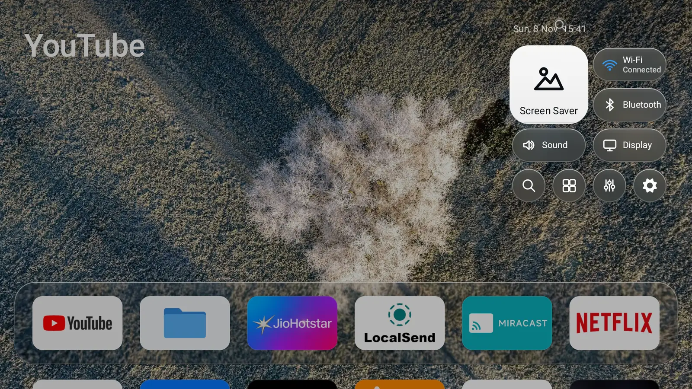

# Sonora

A home screen for Android TV, built the way tvOS works — a glass dock,
Control Center, an app switcher and an aerial screensaver — in plain Java
with **zero third-party dependencies**. No ads, no analytics, no outbound
connections. GPL-3.0.

**[Project page](https://mitunmanav.github.io/sonora)** ·
[Build and install](#build-and-test) ·
[Architecture](docs/ARCHITECTURE.md) ·
[Measurements](docs/perf/2026-11-05.md)



## Measured on the same TV

One Mi TV Stick, Android 11, 2 GB RAM, same debloated system, same
12-key walk across the home screen — only the launcher changed
(`docs/perf/`):

| | Sonora | Google TV |
|---|---|---|
| Launcher memory at idle | ~37 MB | ~181 MB |
| Launcher memory after the walk | ~36 MB | ~275–288 MB |
| Frames missing their deadline | ~0.9% | ~6–8% |
| Slowest 1% of frames | ~23 ms | ~105–200 ms |
| Slow UI-thread events | 0 | 13 |
| Memory left free for apps | ~900 MiB | ~810 MiB |

Google TV's process also hosts its recommendation rows and channel
logos; Sonora does none of that work. Sonora's figures are the
current build (the `phase1b` run); Google TV's are two runs that agreed
within 10%. [`docs/perf/2026-11-05.md`](docs/perf/2026-11-05.md) records
the method, the caveats and the raw `dumpsys` output.

## Why it is different

- **It is the home app.** It does not need an accessibility service —
  the mechanism most alternative launchers use to catch the Home button.
  There is no accessibility service, no receiver, and no background
  service except the screensaver's dream service.
- **No libraries, Android 6.0+.** No AndroidX, Compose, Flutter or Kotlin
  runtime — only platform APIs. The springs behind focus are solved by
  hand in `ui/Spring.java`.
- **Every effect has a low-memory answer.** `DeviceTier` reads the RAM
  and picks LOW / MID / HIGH; a 1 GB stick gets half-size wallpaper,
  frosted glass and no card shadows, and still looks like itself.
- **A file manager in the box.** `files-core` is a Finder-style file
  manager, bundled into the launcher and shipped standalone as `files/`
  (a 48 KB APK). The Share screen serves files to your phone over LAN
  and dies with the screen.
- **It says what a device cannot do.** Permission-denied features are
  stated in the UI; nothing is faked.

## What it cannot do yet

- No Watch Next or channel rows, and no shortcuts to HDMI inputs.
- No signed release yet: build it and install it over adb.
- On Google TV the stock launcher has to be turned off over adb, and on
  the test stick it came back on after a reboot.
- The 1 GB tier was tested by forcing LOW on a 2 GB TV; no real 1 GB
  hardware has been through it yet.
- Hiding or turning off another app needs a permission most retail TVs
  keep for system apps. The app switcher needs Usage access, granted once.

The [field comparison](https://mitunmanav.github.io/sonora/#field) on the
project page sets Sonora beside Projectivy, AT4K, Vitrine, CleanYourTV and
others. CleanYourTV is the closest in spirit: per-brand debloat tooling plus a
deliberately minimal 572 KB launcher. Sonora is the launcher product itself —
Control Center, switcher, search, settings, screensaver and Files — with a
lighter debloat screen.

## Modules

| Path | What it is |
|---|---|
| `app/` | The launcher (`com.mitun.sonora`): home grid, dock, search, settings, screensaver, app manager, file server. |
| `files-core/` | Android library: the whole Files file manager, shared by both apps. |
| `files/` | Standalone Files app (`com.mitun.files`) — a thin shell around `files-core`. |
| `site/` | The GitHub Pages site, served from `master`. |

## Build and test

Linux/WSL only. Gradle 8.13 via the wrapper; no third-party dependencies
(the only test dependency is JUnit):

```bash
./gradlew :app:testDebugUnitTest :files-core:testDebugUnitTest
./gradlew :app:assembleRelease :files:assembleRelease
./gradlew :app:assemblePerf :files:assemblePerf   # installable without a keystore
```

The `perf` build type is the release build signed with the debug key, so
it installs over a debug build without a keystore — and it is the build
to measure on a device (`scripts/perf.sh` for a quick read,
`scripts/bench.py` + `scripts/perf-ab.md` for the full A/B protocol).

### Install on a TV

```bash
adb connect <tv-ip>:5555
adb install -r app/build/outputs/apk/perf/app-perf.apk
adb shell cmd package set-home-activity com.mitun.sonora/.HomeActivity
```

On Google TV the stock launcher can be turned off with
`adb shell pm disable-user --user 0 com.google.android.apps.tv.launcherx`
(`pm enable` brings it back). Setup details and permission notes are in
[`docs/SETUP-GUIDE.md`](docs/SETUP-GUIDE.md).

## What is in the app

- **Home screen** — hero wallpaper, glass dock, app tiles, top shelf with
  clock and search pill; the grid opens from the dock into a full-screen
  scroll, one scroll value driving dock, rows, wallpaper and glass.
- **Control Center** — tvOS 26 panel: large Screen Saver tile, Wi-Fi /
  Bluetooth / Sound / Display pills, round Search / Apps / Quick
  settings / Settings buttons. Every tile does something the TV can do.
- **App switcher** — glass cards of recent apps, double-press Home; OK
  switches, long OK closes.
- **Search** — local app-name search with its own one-line keyboard; no
  network. The voice key exists only when an assistant answers
  `ACTION_ASSIST`.
- **Settings** — index of pages in the tvOS split layout: Quick
  settings, Home Screen, Clock, Screen Saver, Apps, Tools, System, Mode.
- **Tools** — Device info, Setup guide, Files, Debloat, Setup wizard
  (first run), App manager. All navigate through one `ScreenStack`;
  BACK is always one step.
- **Screensaver** — five bundled aerial stills (CC BY-SA, credited in
  Settings), optional clock, also selectable as the TV's system dream.
- **Files** — Finder-style file manager (sidebar, icon/list views, quick
  look, USB drives) plus a Share screen that serves files over LAN.

## Rules the code keeps

- **Zero dependencies.** Platform APIs only; `ui/Spring` solves springs by hand.
- **No background work.** No Service except the DreamService, no receivers, no alarms.
- **No network** unless the LAN share is switched on. No analytics, ever.
- **`minSdk 23`.** Pure logic lives outside the Activity and is unit-tested.
- **Say what a device cannot do** in the UI. Never ship a fake feature.
- **No Apple assets.** Measure and imitate behaviour; draw every mark ourselves.

## Documentation

- [`AGENTS.md`](AGENTS.md) — working rules for agents (`CLAUDE.md` is a symlink).
- [`docs/ARCHITECTURE.md`](docs/ARCHITECTURE.md) — what the system is: modules, every screen, the rules.
- [`docs/plans/PLAN.md`](docs/plans/PLAN.md) — running project log; append a session section, never rewrite history.
- [`docs/plans/REQUIREMENTS-*.md`](docs/plans/) — dated owner requirements with status.
- [`docs/perf/`](docs/perf/) — measured numbers with method and device.
- [`docs/research/`](docs/research/) — tvOS design and performance research notes.
- [`GLOSSARY.md`](GLOSSARY.md) — the project's domain vocabulary.

## Credits

Written by [Mitun Manav](https://github.com/mitunmanav). Screensaver
photographs under CC BY-SA 4.0: Dietmar Rabich (Dülmen), Tasha~visual
(Ngorongoro), Syrio (Vigo di Fassa), Medoffer (Zhuravlyne Lake),
Bhullargraphic (Punjab). The launcher is not affiliated with Apple or
Google; every mark is drawn for this project.

## Contributing

See [CONTRIBUTING.md](CONTRIBUTING.md): issues and device reports are
welcome; pull requests are not merged — a change arrives as a commit of
the maintainer's own. Security reports go through
[SECURITY.md](SECURITY.md).
