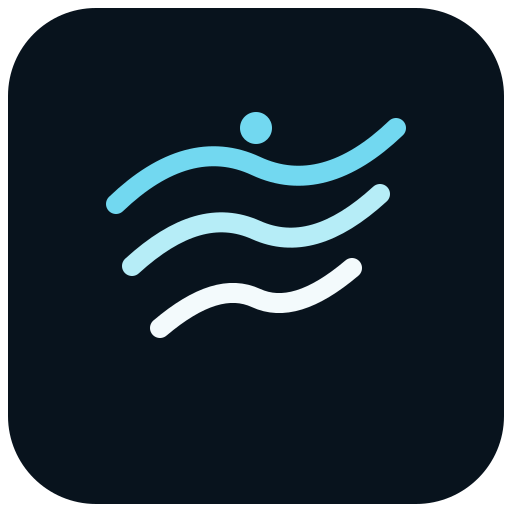
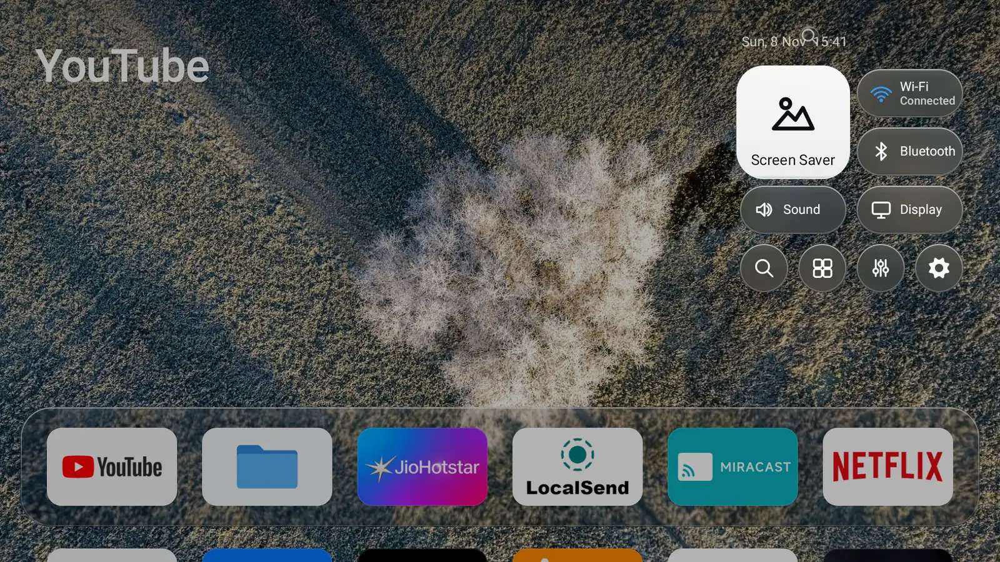
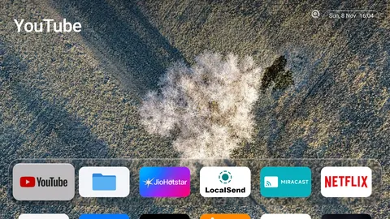
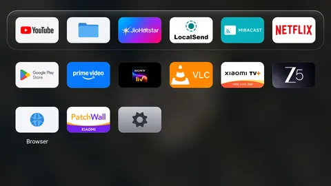
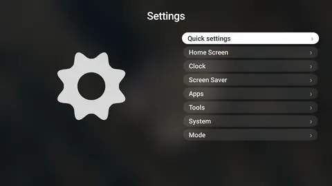
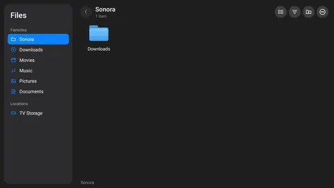

<div align="center">



# Sonora

**A fast, private home screen for Android TV.**

[](https://github.com/mitunmanav/sonora/actions/workflows/ci.yml)
[](LICENSE)


[Website](https://mitunmanav.github.io/sonora) · [Setup guide](docs/SETUP-GUIDE.md) · [Architecture](docs/ARCHITECTURE.md)



</div>

Sonora replaces the stock Android TV launcher with a glass dock, Control
Center, an app switcher and an aerial screensaver. It is written in plain
Java against platform APIs only, and is built for low-memory TV sticks first.

- **Lightweight.** Uses about a fifth of the memory of the stock Google TV launcher on the same device.
- **Private.** No ads, no analytics and no outbound connections.
- **Dependency-free.** No AndroidX, Compose or Kotlin runtime; JUnit is the only test dependency.
- **A real home app.** Registers as the home activity. It needs no accessibility service and runs no background services or receivers.

## Screenshots

| Home | App grid | Settings | Files |
|:---:|:---:|:---:|:---:|
|  |  |  |  |

## Performance

### Sonora vs Clean Your TV 3.6

Same 2 GB Mi TV Stick, Android 11, 1080p at 59.94 Hz, ART `speed`.

| Metric | Sonora | Clean Your TV |
|---|---:|---:|
| Launcher PSS after mixed navigation | **39.4 MiB** | 53.5 MiB |
| Cold first Android frame, median | **273 ms** | 511 ms |
| Mixed navigation deadline misses | 17/1,076 (1.58%) | **0/1,040** |
| Mixed navigation frame p99 | 28 ms | **11 ms** |
| Vertical navigation frame p99 | 27 ms | **11 ms** |
| HOME return to window focus | ~1.04 s | ~1.04 s |

Sonora used 26% less memory after navigation and drew the first cold frame
238 ms sooner. Clean Your TV was smoother on mixed and vertical navigation.
Both cleared every horizontal deadline. Each launcher kept its own layout,
Sonora ran first, and each navigation workload had three trials per launcher.
Time to a usable grid, remote-to-screen latency and performance on other
hardware remain open. [Full comparison and evidence](docs/perf/2026-11-28.md)

### Sonora vs Google TV

Measured on a Mi TV Stick (Android 11, 2 GB RAM) with the same debloated
system and the same 12-key walk across the home screen. Only the launcher
changed between runs.

| Metric | Sonora | Google TV |
|---|---:|---:|
| Memory at idle | ~41 MB | ~181 MB |
| Memory after the walk | ~37 MB | ~275–288 MB |
| Frames missing their deadline | ~0.9% | ~6–8% |
| Slowest 1% of frames | ~23 ms | ~105–200 ms |
| Memory left free for apps | ~900 MiB | ~810 MiB |

Google TV's process also hosts recommendation rows and channel logos, which
Sonora does not provide. The method, caveats and raw `dumpsys` output are in
[`docs/perf/2026-11-05.md`](docs/perf/2026-11-05.md).

## Features

| Feature | Description |
|---|---|
| **Home screen** | Hero wallpaper, glass dock, app tiles and a top shelf with clock and search. The dock opens into a full-screen app grid. |
| **Control Center** | Screen Saver, Wi-Fi, Bluetooth, Sound and Display controls, plus shortcuts to Search, Apps and Settings. |
| **App switcher** | Double-press Home to see recent apps as cards. OK switches; long OK removes a card from the list. |
| **Search** | Offline app search with an on-screen keyboard. A voice key appears only when an assistant is installed. |
| **Settings** | Home Screen, Clock, Screen Saver, Apps, Tools, System and Mode pages in a split layout. |
| **Tools** | Device info, setup guide, app manager, a debloat screen and a first-run setup wizard. |
| **Screensaver** | Five bundled aerial photographs with an optional clock. Can also be set as the system screensaver. |
| **Files** | A Finder-style file manager with sidebar, icon and list views, Quick Look and USB drives. Its Share screen serves files to a phone over the local network while it is open. Also ships as a standalone 48 KB app. |

### Adaptive quality

`DeviceTier` reads the device's RAM and selects a LOW, MID or HIGH profile.
Every costly effect has a LOW variant: on a 1 GB device Sonora uses a
half-size wallpaper, frosted rather than live glass, and no card shadows.

## Getting started

### Requirements

- An Android TV device running Android 6.0 (API 23) or later
- [`adb`](https://developer.android.com/tools/adb) with network debugging enabled on the TV
- JDK 17 and a Linux or WSL shell to build from source

### Build

```bash
./gradlew :app:testDebugUnitTest :files-core:testDebugUnitTest   # unit tests
./gradlew :app:assembleRelease :files:assembleRelease            # release builds
./gradlew :app:assemblePerf                                      # installable build for devices
```

The `perf` build is the release build signed with the debug key. It installs
without a keystore and is the build to use for on-device measurements.
See the [paired benchmark protocol](scripts/perf-ab.md) for device setup,
trial order and evidence capture.

### Install

```bash
adb connect <tv-ip>:5555
adb install -r app/build/outputs/apk/perf/app-perf.apk
adb shell cmd package set-home-activity com.mitun.sonora/.HomeActivity
```

On Google TV, disable the stock launcher so it does not take Home back:

```bash
adb shell pm disable-user --user 0 com.google.android.apps.tv.launcherx   # pm enable restores it
```

See the [setup guide](docs/SETUP-GUIDE.md) for permissions and device-specific notes.

## Project structure

| Path | Contents |
|---|---|
| [`app/`](app) | The launcher (`com.mitun.sonora`): home, dock, search, settings, screensaver, tools. |
| [`files-core/`](files-core) | The file manager as an Android library, shared by both apps. |
| [`files/`](files) | The standalone Files app (`com.mitun.files`). |
| [`scripts/`](scripts) | Deployment, profiling and benchmark scripts. |
| [`docs/`](docs) | Architecture, research notes, plans and performance records. |
| [`site/`](site) | The project website, deployed to GitHub Pages. |

## Design principles

- **Platform APIs only.** Animation springs are solved by hand in `ui/Spring.java`.
- **No background work.** The screensaver's dream service is the only service.
- **No network by default.** The only listener is the LAN share, and only while its screen is open.
- **Testable logic.** Logic lives outside the Activity and is covered by unit tests.
- **No fake features.** When a device does not allow something, the UI says so.
- **Original artwork.** Behaviour is modelled on tvOS; every icon and mark is drawn for this project.

## Known limitations

- No Watch Next or HDMI-input rows.
- No signed release yet; build from source and install with `adb`.
- On Google TV, the stock launcher may re-enable itself after a reboot.
- The 1 GB profile has been tested by forcing LOW on a 2 GB device, not yet on 1 GB hardware.

## Documentation

| Document | Contents |
|---|---|
| [Architecture](docs/ARCHITECTURE.md) | Modules, screens and the rules the code follows. |
| [Setup guide](docs/SETUP-GUIDE.md) | Installation and permissions. |
| [Performance](docs/perf/) | Measurements with method and device. |
| [Research](docs/research/) | Design and performance research notes. |
| [Project log](docs/plans/PLAN.md) | Session history and dated requirements. |
| [Glossary](GLOSSARY.md) | Domain vocabulary. |
| [Agent rules](AGENTS.md) | Working rules for coding agents. |

## Contributing

Bug reports and device reports are welcome. Pull requests are not merged
directly: accepted changes are re-applied by the maintainer. See
[CONTRIBUTING.md](CONTRIBUTING.md). Report security issues privately as
described in [SECURITY.md](SECURITY.md).

## License

Sonora is released under the [GNU General Public License v3.0](LICENSE).

Screensaver photographs are licensed under CC BY-SA 4.0 and credited to
Dietmar Rabich (Dülmen), Tasha~visual (Ngorongoro), Syrio (Vigo di Fassa),
Medoffer (Zhuravlyne Lake) and Bhullargraphic (Punjab).

Sonora is not affiliated with Apple or Google.

---

<sub>Created by [mitunmanav](https://github.com/mitunmanav).</sub>
